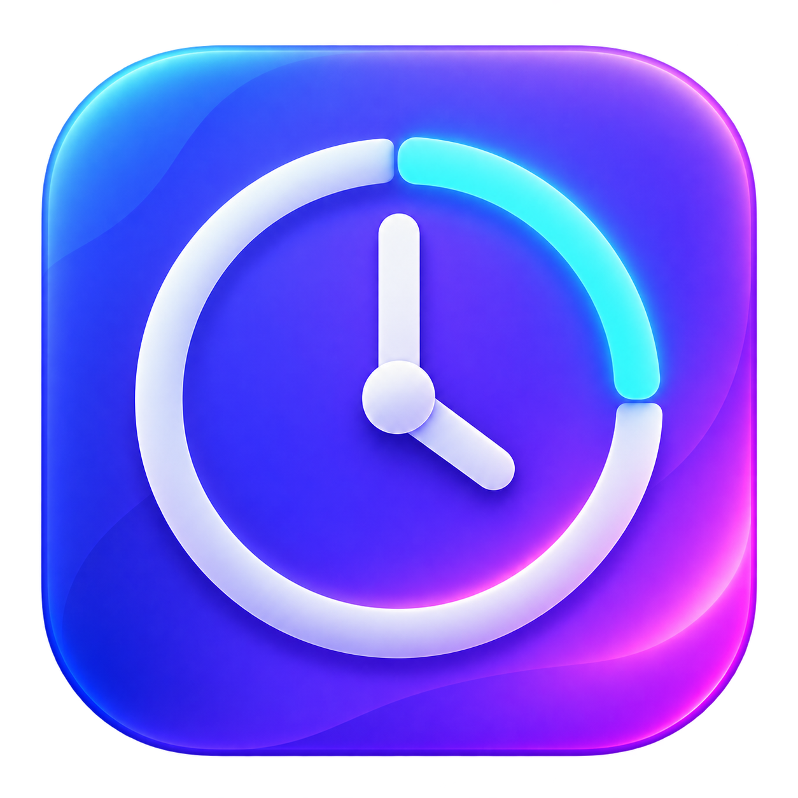

# 先做一刻 · FirstStep

<p align="center"></p>

本地运行的 macOS 专注工具：任务收集箱、悬浮番茄钟、每日专注森林与周月统计、Chrome 分心网站屏蔽，以及每天 07:00–20:00 的手动时间记录。MIT 开源。

Mac 自用的轻量专注工具：写下今天的核心任务，选 15 / 25 / 30 / 45 分钟开始。右上角悬浮小窗显示当前任务与倒计时；Chrome 扩展暂时屏蔽你设置的网站，初始包含雪球、X、微博。

## 首次使用

下载或克隆本仓库后安装。需要 macOS 13+、Swift Command Line Tools、Python 3；测试额外需要 Node.js 18+。当前在 Apple Silicon Mac 上验证，Intel 尚未实机验证。

```sh
xcode-select --install
python3 --version
```

如果已安装 Command Line Tools，可跳过第一条。

升级前先结束专注并退出旧应用。安装程序会更新本地主机并让已连接的扩展自动重连，保留已有记录。应用 0.6.0 继续使用扩展 0.2.0，无需再次授权网站权限。

1. 双击本目录的 `安装.command`。应用安装到 `~/Applications/先做一刻.app`，随后自动打开。
2. 按 [安装说明](安装说明.md) 在自己的 Chrome 中加载本地扩展。已安装并连接的用户可以跳过。
3. 应用显示「Chrome 已连接」后，添加任务、选中任务，点击开始。扩展未连接时只能计时，界面会明确提示。

扩展目录：`~/Library/Application Support/FirstStep/ChromeExtension`。
Chrome 中打开 `chrome://extensions` → 开启「开发者模式」→「加载已解压的扩展程序」。文件选择框按 ⌘⇧G，输入上面的完整路径并选择该文件夹。Chrome 不必关闭；我们不接管你的浏览器。

无痕窗口需要在扩展详情中单独允许；其他 Chrome 用户配置需要分别加载。其他浏览器不在本版本的限制范围内。

从旧版升级到应用 0.3.0 / 扩展 0.2.0 后，请在 `chrome://extensions` 重新加载扩展，确认新增的网站权限；在扩展详情中允许访问所有网站。应用会检测旧扩展和权限缺失，未就绪时明确提示仅计时。

## 使用约定

- 默认 15 分钟，下一步可不填。任务保留，未完成的任务次日仍可继续。
- 开始后，已经打开的相关网站也会进入拦截页；结束后恢复原网址。
- 临时访问：点击临时访问 → 可选填写原因 → 开始等待 30 秒 → 再次确认后，单站开放 5 分钟。不会自动放行。
- 提前结束和正常退出：先等待 30 秒，再确认。关闭主窗口不会结束计时。
- 浮窗可以拖动；菜单栏的倒计时可以重新打开主窗口。不会强制自动开始下一轮。
- 记录只保存在本机。临时放行时段从记录的专注时间中扣除；这表示可用时段，不监视你是否实际浏览。
- 主动停用扩展仍能绕过。扩展断连时按已知截止时间解除；电脑休眠期间不会唤醒电脑，恢复后重新核对时间。

## 收集箱

左侧点击「收集箱」，输入一个标题并按回车或点「收进来」，先暂存生活杂事和工作待办。只填写标题，最多 120 个字，不会自动排进今天，也不会启动番茄钟。

- 可以修改标题，删除后可点「撤销删除」。条目按新加入的在前显示，退出应用后仍会保留。
- 准备处理时点「移到今天」：从收集箱移出，在「今天的事」中选中该任务；之后自行选择时长并开始。
- 正在专注时也可以先记一件事、或把它排到今天，当前倒计时不会中断或自动切换任务。
- 定期回看，把准备做的事改写成一个能开始的动作。本功能采用 GTD 的收集和下一步行动思路，界面保留一张简单暂存清单。[GTD 官方流程](https://gettingthingsdone.com/what-is-gtd/)

## 屏蔽网站

左侧点击「屏蔽网站」，粘贴完整网址或域名，查看预览后点击「加入屏蔽」。例如 `https://www.bilibili.com/video/abc?from=home` 会保存为 `bilibili.com`，覆盖该域名及其子域。路径、参数和片段不会保存。

- 仅在番茄钟专注期间生效，结束后恢复访问；已经打开的匹配页面也会进入拦截页。
- 按输入域名屏蔽，不会自动扩大到上级域名：添加 `news.example.com` 不会屏蔽 `work.example.com`。常见的 `www.` 前缀会去掉。
- 初始包含雪球、X/Twitter、微博。可添加、移除，最多 100 组；同一网站与范围重叠的域名不能重复添加。
- 专注期间禁止增删列表；自定义网站也支持原有 30 秒等待后的单站 5 分钟临时访问。
- 列表为空时仅计时。只支持网站域名，不支持 IP、本机地址或 `chrome://` 等浏览器内部页面。

为方便以后只在 Mac 粘贴网址就加入屏蔽，扩展需要一次性获得 HTTP(S) 网站访问权限。程序只根据列表匹配页面地址，不读取网页正文，也不上传浏览记录；工作网站不会因为授予权限而进入屏蔽列表。

## 时间记录

左侧点击「时间记录」即可使用。默认显示周一至周日，可以切换单日，或通过日期控件、前后箭头和「今天」回看其他日期。

- 每天 07:00–20:00；点击空白或拖选时间段，填写事情、日期、起止时间、颜色和可选备注，再保存。
- 点击已有记录修改。拖动卡片移动时间；周视图可横向拖到另一日。拉动上下边缘调整起止，拖动按半小时对齐；手工填写支持分钟精度。
- 重叠记录并排显示。删除后可点击「撤销」。
- 完全手动填写，不会把番茄钟记录自动放入日历。

「时间记录」是全天活动的手动回顾；「专注记录」是番茄钟自动生成的明细。两者可以涵盖同一段时间，时长不应相加，也无需把每轮番茄钟重新抄入时间记录。左下角「今天已专注」只按番茄钟记录计算。

## 专注记录、每日森林与周月统计

左侧点击「专注记录」，查看当天完成的番茄钟数量、实际专注分钟和提前结束次数。每天独立一片森林，可通过周一至周日日期栏、前后箭头、「今天」和日期控件回看。

- 完整结束一轮种一棵树：15 分钟小树、25 分钟正常树、30 分钟稍大的树、45 分钟大树。提前结束留下树坑，不增加完成数量。
- 点击树、树坑或下方明细，查看对应任务、起止时间、实际专注分钟与临时访问次数。明细默认显示最新三条，可以展开全部。
- 按专注开始时的本地日期归档，跨午夜的轮次归开始当天。临时开放网站的时间扣除后计入专注分钟，树大小仍按原定时长显示。
- 已保存的旧记录自动生成森林，无需重新填写。本版起本地历史不再只保留最近 500 条；旧版已删除的更早记录无法补回。Chrome 只接收最多 500 条的状态快照，不会因此删除本地历史。
- 数据继续只保存在本机，未与手动「时间记录」合并，也没有新增 Chrome 权限。

切换页面右上角「日／周／月」查看不同范围：

- 「日」保留每日森林和明细；「周」按周一至周日显示每天的专注时长；「月」按每月 1 日至月底、以自然周分组显示时长。
- 周、月顶部只汇总总专注时长和完成番茄钟数量。月初、月末的部分周只计算当月日期；柱子显示具体日期范围。
- 指向或点击柱子，查看对应日期的时长和完成数量。用前后箭头、日期控件和「本周／本月」回看历史或返回当前。
- 时长沿用实际专注秒数，包含提前结束前的投入，扣除临时访问时段；完成数量只计算完整结束的轮次。按开始日期归档，旧记录自动统计，无需迁移。

## 数据和卸载

专注任务与记录：`~/Library/Application Support/FirstStep/state.json`；手动时间记录：同目录下的 `time-records.json`。退出应用后可复制此目录备份。不要在专注进行中手动修改数据。

卸载：先结束专注；在 Chrome 删除「先做一刻 · 专注守护」扩展；退出并移除 `~/Applications/先做一刻.app`。本地主机配置位于 `~/Library/Application Support/Google/Chrome/NativeMessagingHosts/com.dayuan.firststep.json`，可移除。个人记录默认保留在 FirstStep 目录，是否删除由你决定。

## 构建和验证

运行要求 macOS 13+，源码使用 Swift 5.9+。已在 Apple Silicon / macOS 26.6.2、Swift 6.4 CLT + macOS 26.5 SDK 构建；脚本自动选择 SDK 和当前架构的构建路径。部分 SDK 27 CLT 缺少 SwiftUI 宏插件时，会尝试已安装的同目录 26.5 SDK，也可用 `FIRSTSTEP_SWIFT_SDK=/path/to/MacOSX.sdk` 指定。无 npm 依赖，不需要 Xcode 完整版。

```sh
./scripts/test-core.sh
./scripts/test-daily-forest.sh
./scripts/test-statistics.sh
./scripts/test-inbox.sh
./scripts/test-blocked-sites.sh
./scripts/test-time-log.sh
./scripts/build.sh
./scripts/test-forest-hit.sh
node --test Tests/*.test.mjs
python3 Tests/native_protocol.py
./scripts/test-app-model.sh
./scripts/install.sh
```

应用使用本地 ad-hoc 签名，仅供本机使用，没有 Apple 公证。测试结果及实机验证范围见 `docs/verification.md`。

实现：SwiftUI / AppKit + Chrome Manifest V3 + Native Messaging。Swift 状态机负责等待和放行；文件锁与原子写入避免多进程覆盖。扩展通过 Chrome DNR 匹配配置的域名，不读取网页正文；不修改系统 hosts 文件。状态文件升级为 schema 3，兼容迁移 1/2，旧版主机拒绝写入。收集箱到今天的转移使用同一次事务，收集箱内容不发送给 Chrome；时间记录文件格式不变。

接口依据（核查日期 2026-10-16）：[Chrome DNR](https://developer.chrome.com/docs/extensions/reference/api/declarativeNetRequest)、[Native Messaging](https://developer.chrome.com/docs/extensions/develop/concepts/native-messaging)。


## 开源与贡献

代码采用 [MIT License](LICENSE)。应用图标由 AI 生成，选用的紫色版本保存在 `assets/AppIcon.png`。欢迎通过 Issue 描述问题、复现步骤、系统/Chrome 版本；提交记录或截图前请自行移除个人信息。

本仓库只包含程序、图标、测试和说明，不包含用户的任务、时间记录、浏览器配置或授权信息。
